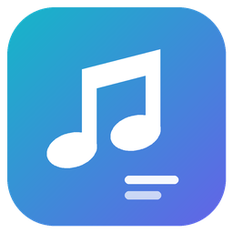

<p align="center"></p>

# LyricBar JP

Windows 11 任务栏歌词工具，优先识别 Windows 版 Apple Music，显示原文歌词和已有中文译文。

基于 [ysheng920/LyricBar](https://github.com/ysheng920/LyricBar) 的独立修改版，沿用 MIT 许可证。当前版本 **1.5.1**。

[下载 Windows x64 版](https://github.com/ERiC808222/LyricBar-JP/releases/latest) · [更新记录](CHANGELOG.md) · [项目来源](UPSTREAM.md) · [验证范围](docs/VALIDATION.md)

## 功能

- 自动读取系统媒体会话中的歌曲、歌手、封面和播放进度，优先选择 Apple Music。
- 支持日语、韩语、藏语、法语、西班牙语等原文显示与检索；可显示同一句的中文译文。
- 七种界面语言：简体中文、English、日本語、한국어、བོད་ཡིག、Français、Español。
- 切句支持交叉渐变、从左滑入、从下浮现、从左渐显；切歌时封面、曲名和歌手一起过渡。
- 封面圆角裁剪，位置解锁拖动、宽度调整、多显示器放置，以及明暗主题。
- 歌词提前/延后调节（±10 秒、每次 0.1 秒）、长句滚动等待与渐变时长调节。
- 可选开机自启、全屏时保持置顶；关闭全屏置顶时，同屏全屏会暂时隐藏歌词。
- 支持导入本地双语 LRC，兼容 UTF-8、UTF-16 和日文 Shift-JIS。
- 修复高 DPI 缩放下刷新/重置后歌词消失，启动时可自动找回屏幕外位置。


以上为实际 WPF 控件渲染，使用原创演示文字与自绘封面，未打包歌曲歌词。

## 下载与使用

1. 在 [Releases](https://github.com/ERiC808222/LyricBar-JP/releases/latest) 下载 `LyricBar-JP-v1.5.1-win-x64.zip`，解压到固定目录。
2. 安装 **.NET 9 Desktop Runtime x64**（需要 Desktop Runtime，而不是仅 .NET Runtime）。[微软下载页](https://dotnet.microsoft.com/download/dotnet/9.0)。
3. 运行 `LyricBarJP.exe`，再打开 Windows 版 Apple Music 播放歌曲。
4. 右键托盘图标设置歌词来源、界面语言、显示效果、开机自启等；双击托盘图标切换位置锁定。

程序使用便携式配置：设置、导入歌词与索引缓存存放在 EXE 旁的 `Data` 目录。请使用有写权限的文件夹。更新时退出旧版、替换程序，保留原 `Data` 目录；开机自启已开启时，运行新位置的程序会更新该启动路径。

## 歌词来源与范围

歌词按当前设置从以下来源检索，实际来源可在托盘菜单和歌词条提示中查看：

- Apple/iTunes 目录用于核对歌曲身份与地区曲名；Apple 歌词由 **Paxsenix 第三方接口**转发，并非 Apple 官方公开歌词 API。
- [AMLL 社区 TTML 歌词库](https://github.com/amll-dev/amll-ttml-db)。
- 网易云音乐、QQ 音乐、LRCLIB、酷狗等既有在线歌词来源。
- 用户自行导入的本地 LRC。

中文第二行使用歌词源已有的译文，没有内置机器翻译。某首歌有原文并不代表有中文译文；检索失败或版本不符时可手动导入 LRC。第三方接口可能限流或暂时失效。仓库和发布包均不分发下载的完整歌词、索引缓存或系统字体。

藏语界面为初译，尚未经母语者审校。常规置顶窗口也无法保证覆盖独占全屏游戏。

## 从源码构建

需要 Windows x64 和 .NET 9 SDK：

```powershell
git clone https://github.com/ERiC808222/LyricBar-JP.git
cd LyricBar-JP
powershell -NoProfile -ExecutionPolicy Bypass -File Build-JP.ps1
```

程序位于 `publish/LyricBarJP.exe`。默认依赖桌面运行库；如需将运行库一并打包：

```powershell
powershell -NoProfile -ExecutionPolicy Bypass -File Build-JP.ps1 -SelfContained
```

运行行为检查（不会改变音乐播放）：

```powershell
dotnet run --project Tests/LyricBar.Tests.csproj -c Release
```

Windows 实际窗口诊断使用屏幕外测试窗口，输出 JSON：

```powershell
.\publish\LyricBarJP.exe --verify-visibility visibility.json
.\publish\LyricBarJP.exe --verify-fullscreen fullscreen.json
.\publish\LyricBarJP.exe --render-multilingual motion-proof
```

## 来源与许可证

原项目：[ysheng920/LyricBar](https://github.com/ysheng920/LyricBar)，基于提交 `8d21e853ff2ada701e25a3a362904a5f4ea5be3a`。保留原作者和贡献者的 MIT 版权声明；详见 [LICENSE](LICENSE) 和 [UPSTREAM.md](UPSTREAM.md)。本项目与 Apple 无隶属关系。

LyricBar JP is a Windows 11 taskbar lyrics overlay derived from LyricBar. It prioritizes Apple Music media sessions, supports multilingual original lyrics with existing Chinese translations, and includes configurable transitions, timing offsets, fullscreen behavior and DPI-safe recovery. Windows x64 and .NET 9 Desktop Runtime are required.
